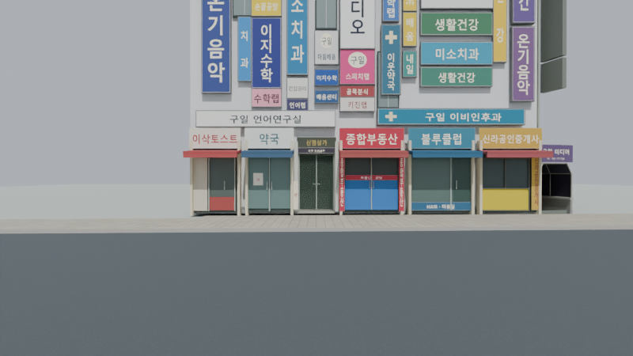
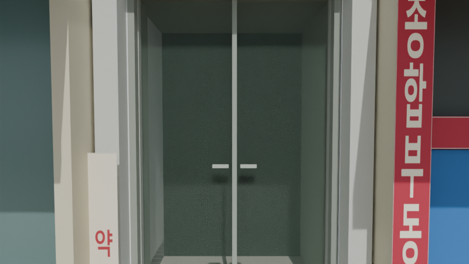
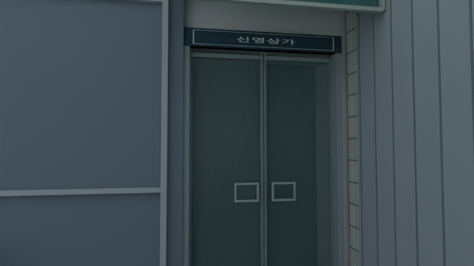
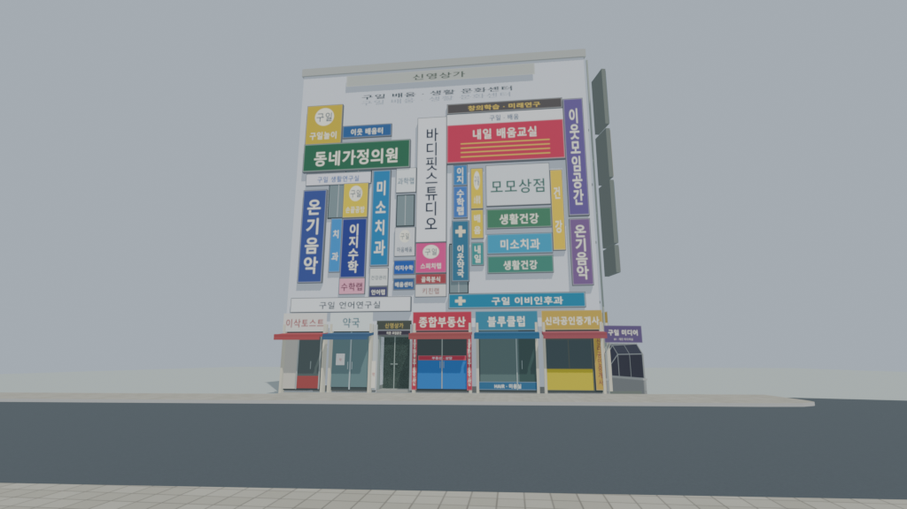

# 구일 2026 · UE5 1인 탐험

2026년 구일의 실제 위치와 동네 분위기를 바탕으로 미니어처풍 1인칭 탐험 공간을 만듭니다. 엔진은 **Unreal Engine 5**, 우선 혼자 탐험하는 범위이며 유료 에셋·플러그인·구독은 사용하지 않습니다.

## 신영상가 앞에서 뒷문까지 걷기

Windows에서 UE5와 기본 1인칭 Blueprint 팩이 설치되어 있으면 저장소 루트의 **[Play-Guil.cmd](Play-Guil.cmd)** 를 실행합니다. 첫 실행에는 UE 에디터가 신영상가 레벨을 만들고 보행 검사를 마친 뒤 게임 창을 엽니다. 이후에는 같은 레벨로 바로 시작합니다. [집 PC에서 받기와 실행](docs/집_작업_인수인계.md) · [에디터에서 직접 여는 방법](docs/UE5_자산_가져오기.md)

시작하면 정면의 서측 정문이 보입니다. 맞은편 보도에서 도로를 건너 약국 옆 정문을 지난 뒤 오른쪽으로 돕니다. 상가를 왼쪽에 두고 지하계단 바깥을 돌아 남측과 동측을 따라가면, 기계식 주차장 옆 후면 양개문 앞에 도착합니다. 이동은 WASD, 시선은 마우스입니다.

| 맞은편 보도 | 서측 정문 | 동측 뒷문 |
| --- | --- | --- |
|  |  |  |

세 장과 [약 29초 길이의 1인칭 경로 영상](exports/guil-street-ue5/walk/shinyeong_walkthrough.mp4)은 Blender에서 모델 지면 위 1.65m에 카메라를 두고 렌더한 화면입니다. 영상에서는 정문 앞에서 멈췄다가 남쪽 모퉁이를 돌아 뒷문까지 이동합니다.

동선의 평면 길이는 100.3m입니다. 반경 42cm, 높이 1.92m의 캐릭터를 가정해 675개 지점에서 발밑과 건물 사이 여유를 검사했습니다. 보도 턱의 최대 단차는 모델 기준 24cm입니다. 서측 도로의 횡단보도 위치와 남측·후면 바닥의 실제 높이는 미확인입니다. [동선 좌표](exports/guil-street-ue5/shinyeong_walk.json) · [Blender 검증 기록](exports/guil-street-ue5/walk/qa_shinyeong_walk.json)

이 PC에서 UE5 에디터를 찾지 못해 실제 레벨 파일은 집 PC의 에디터에서 처음 생성합니다. UE 충돌과 키보드·마우스 보행, 집 PC의 FHD 120fps는 아직 실측 전입니다.

## 현재 만들어진 것

- [신영상가 앞 거리 FBX](exports/guil-street-ue5/guil-street.fbx)와 [Blender 편집본](exports/guil-street-ue5/guil-street.blend): 2025년 수치지도의 신영상가 주변 **120m × 110m** 안에서 도로 구역 2개와 보도 8개를 면으로 만든 초기 자산입니다. [도로 텍스처](exports/guil-street-ue5/T_GuilRoad.png)와 [보도 텍스처](exports/guil-street-ue5/T_GuilWalkway.png)는 자체 제작한 미니어처풍 임시 표현입니다.
- [신영상가 UE용 참고 FBX](exports/shinyeong-ue5-transfer/shinyeong-v13-ue-groups.fbx)와 [Blender 편집본](exports/shinyeong-ue5-transfer/shinyeong-v13.blend): 기존 외관 모델을 재질 48개 이하의 6개 메시로 나누었습니다. 일부 간판은 과거 가상 상호이고 치수는 추정이므로 2026년 완성 모델로 취급하지 않습니다.
- [구일 2D 지도](docs/guro1_plan_2d.geojson), [평면도](docs/reference/구로1동_2D평면도.svg), [격자 조사](docs/reference/구로1동_격자조사.md), [구일 지도 기준](docs/구일_지도_기준.md): 배치와 기존 관찰을 계속 참고합니다.
- [UE5 가져오기 안내](docs/UE5_자산_가져오기.md)와 [가져오기 도구](tools/import_guil_fbx.py): 두 FBX를 UE5 에디터의 새 자산 폴더로 가져오기 위한 준비입니다. 기존 레벨이나 자산을 덮어쓰지 않으며 UE에서의 실행은 아직 검증하지 못했습니다.



위 이미지는 Blender에서 초안을 확인한 화면입니다. 기존 신영상가의 간판에는 가상 상호가 남아 있으며, 선택한 미니어처풍의 최종 화면이나 UE 게임 화면이 아닙니다.

## 집에서 이어가기

집 PC의 `C:\seoul_3Dgame`이 기존 `main` 작업 폴더라면 PowerShell에서 실행합니다.

```powershell
cd C:\seoul_3Dgame
git status --short --branch
git pull --ff-only origin main
if ($LASTEXITCODE -eq 0) { .\Play-Guil.cmd }
```

처음 받기, 이전 이력 때문에 pull이 중단된 경우, UE5 설치 경로 지정과 첫 실행 로그 위치는 [집 작업 인수인계](docs/집_작업_인수인계.md)에 있습니다.

## 지도와 모델의 한계

2D 지도는 2026-09-30에 수집한 OpenStreetMap 기반 도형과 수기 추정을 포함합니다. [OpenStreetMap 기여자와 ODbL 1.0](https://www.openstreetmap.org/copyright)을 출처로 표시합니다. 거리 FBX는 2025년 국토지리정보원 1:1,000 수치지도의 도로 구역·보도 도형을 사용합니다. 2025년 자료를 2026년 현장 실측으로 단정하지 않습니다.

도로 구역 도형에는 보도가 포함됩니다. 보도를 위에 표시한 **시각 초안**이지 순수 차도 면적이나 모든 도로폭을 확정한 자료가 아닙니다. 연석 높이 12cm, 포장 무늬와 미확인 구역의 바닥은 임시값입니다. 참고 건물의 지하 계단을 가리지 않도록 바닥에 여유 공간을 두었으나 그 사각형은 실제 지하 입구의 측량 경계가 아닙니다. 2D 출처·축·가정은 [지도 기준](docs/구일_지도_기준.md)과 [생성 기록](exports/guil-street-ue5/street_build_report.json)에 있습니다.
